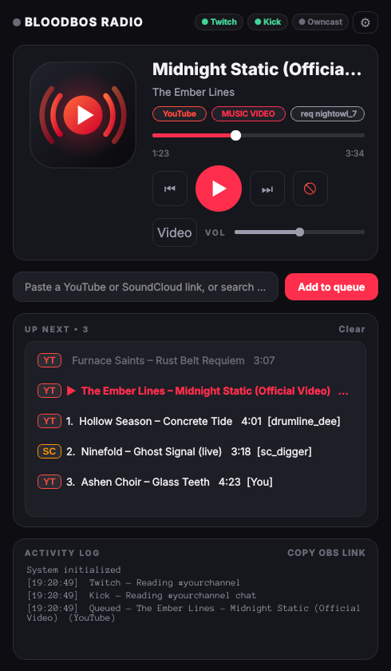
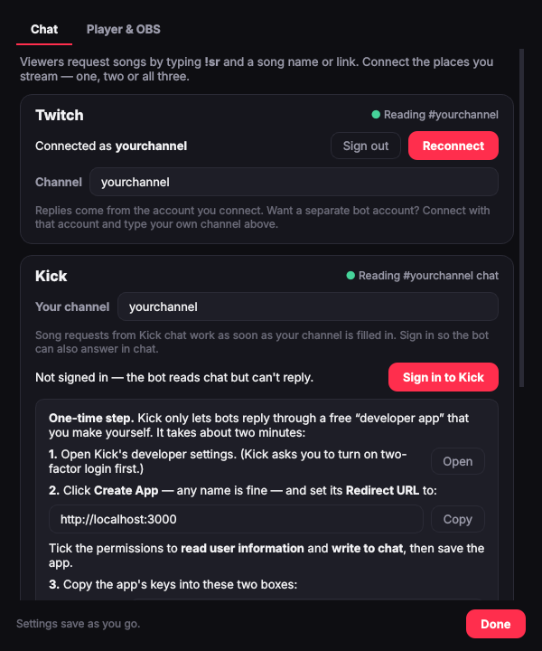

# BLOODBOS RADIO

**Song requests for your stream.** Viewers type `!sr` and a song name or link in
chat — on **Twitch, Kick and Owncast**, at the same time — and the song is found on
**YouTube or SoundCloud**, queued and played. Music videos play too, and a
now-playing card shows up in **OBS**.

<p align="center">
  
  &nbsp;&nbsp;
  
</p>

---

## Download

| Your computer | Download | |
|---|---|---|
| **Windows 10 / 11** | [**BLOODBOS-Radio-Setup-Windows.exe**](https://github.com/korn788/BloodBos-music-request-bot/releases/latest/download/BLOODBOS-Radio-Setup-Windows.exe) | double-click it |
| **Mac with an Apple chip** (M1, M2, M3, M4…) | [**BLOODBOS-Radio-macOS-AppleSilicon.dmg**](https://github.com/korn788/BloodBos-music-request-bot/releases/latest/download/BLOODBOS-Radio-macOS-AppleSilicon.dmg) | open it, drag the app to Applications |
| **Mac with an Intel chip** | [**BLOODBOS-Radio-macOS-Intel.dmg**](https://github.com/korn788/BloodBos-music-request-bot/releases/latest/download/BLOODBOS-Radio-macOS-Intel.dmg) | open it, drag the app to Applications |
| **Linux** (any) | paste one line into a terminal — see below | |
| **Ubuntu / Debian / Mint / Pop!_OS** | [**bloodbos-radio_amd64.deb**](https://github.com/korn788/BloodBos-music-request-bot/releases/latest/download/bloodbos-radio_amd64.deb) | double-click it |

Not sure which Mac you have? Click the Apple menu  → **About This Mac**. If it says
"Chip: Apple M…", get the Apple chip version; if it says "Processor: Intel", get Intel.

Everything the player needs (including VLC) comes with it — there's nothing else to install.

### Installing on Windows

1. Double-click **BLOODBOS-Radio-Setup-Windows.exe**.
2. Windows may show a blue box saying *"Windows protected your PC"* (this happens with
   every new free app). Click **More info**, then **Run anyway**.
3. Click **Next** a couple of times, then **Finish**. The app opens by itself.

No administrator password is needed. To uninstall: Settings → Apps → BLOODBOS Radio → Uninstall.

### Installing on a Mac

1. Open the **.dmg** you downloaded and drag **BLOODBOS Radio** onto **Applications**.
2. Open BLOODBOS Radio from your Applications folder.
3. The first time, macOS may say it *"can't be opened"* or *"can't check it for malicious
   software"* (it says that about any free app that isn't sold through Apple). Click
   **Done**, then open **System Settings → Privacy & Security**, scroll down, and click
   **Open Anyway** next to BLOODBOS Radio. Enter your password. You only do this once.

### Installing on Linux

Open a terminal, paste this line and press Enter:

```bash
curl -fsSL https://raw.githubusercontent.com/korn788/BloodBos-music-request-bot/main/install.sh | bash
```

It installs VLC if you don't have it (asks for your password for that), sets the app up
in your home folder, and adds it to your app menu. Run the same line again any time to
update. Works on Ubuntu, Debian, Mint, Pop!_OS, Fedora, Arch, CachyOS, Manjaro,
EndeavourOS and openSUSE. To remove it: `bash <(curl -fsSL https://raw.githubusercontent.com/korn788/BloodBos-music-request-bot/main/install.sh) --uninstall`

On Ubuntu, Debian, Mint or Pop!_OS you can instead download the **.deb** above and
double-click it.

---

## First start: connect your chat

The **Setup** window opens by itself the first time (later: click the ⚙ button, or any
of the Twitch / Kick / Owncast pills at the top of the player).

**Twitch** — click **Connect Twitch**. Your browser opens Twitch; click **Authorize**.
Done. (The bot replies from the account you sign in with. Want a separate bot account?
Sign in with the bot account and type your own channel name in the Channel box.)
Twitch asks apps to renew this login about every two months — the app reminds you.

**Kick** — type your channel name (the part after `kick.com/`). Song requests from Kick
chat work right away: the app reads Kick chat straight from Kick, with no login and no
server, and if Kick's newer chat system ever acts up it switches to the older one by
itself. To let the bot *answer* in Kick chat, click **Sign in to Kick**.
If this version of the app doesn't include a Kick app, the Setup window shows three
short steps to make your own free one on Kick (Kick requires that for bots, and asks you
to have two-factor login turned on first).

**Owncast** — type your Owncast address (like `stream.example.com`) and your Owncast
**admin password**, then click **Connect**. The app uses the password once to create a
"Music Bot" chat user on your server and never saves it. (Or click *"I have an access
token instead"* and paste one from Owncast's Admin → Integrations → Access Tokens.)

The little pills at the top of the player show how each one is doing:
🟢 reading chat · 🟡 working on it / can't reply yet · 🔴 needs attention (hover for why) · ⚪ not set up.

## Add it to OBS

1. In the player, click **COPY OBS LINK** (just above the activity log).
2. In OBS, click **+** under *Sources* → **Browser**. Paste the link into **URL**.
   Set **Width 560** and **Height 500**. Click **OK**.

The now-playing card appears in the bottom-right of that source, and music videos pop
up above it. The **sound** plays through the app like any other program — your viewers
hear it if OBS captures your desktop audio (or add an *Application Audio Capture* source
for BLOODBOS Radio on Windows).

## Chat commands

| Command | What it does | Who |
|---|---|---|
| `!sr <song name or link>` | Request a song (YouTube link, SoundCloud link, Spotify link, or just a name). Also `!addsong`, `!request`, `!play <song>` | everyone |
| `!sc <SoundCloud link>` | Request a SoundCloud track | everyone |
| `!song` | What's playing right now | everyone |
| `!queue` | The next five songs | everyone |
| `!help` | List the commands | everyone |
| `!skip` `!back` `!pause` `!play` `!volume 0-100` `!clear` | Control playback | you and your mods* |

\* Tick **Let every viewer control playback** in Setup → *Player & OBS* to open these up to everyone.

In the player you can also paste links or search, right-click any song in the queue
(*Play now*, *Play next*, *Move up/down*, *Remove*, *Block*), and use the 🚫 button to
stop a song instantly and block it from ever being requested again.

## Questions

**Nothing plays the first time I start it.** On the very first start the app downloads
its YouTube helper (yt-dlp, and a small JavaScript runtime YouTube now requires). It says
*"YouTube support ready"* in the activity log when it's done — usually under a minute.
After that it keeps them up to date by itself.

**"Sign in to confirm your age" / some videos won't play.** In Setup → *Player & OBS*,
pick the browser you're signed in to YouTube with under *Age-restricted videos*
(Firefox works best; close Chrome/Edge first if you pick those).

**Kick requests don't show up.** Check the channel name in Setup (just the name, like
`yourname`). The log says which Kick chat system it's on (`reading #yourname chat
(Centrifugo)` or `(Pusher)`). To test one on purpose, set `"feed": "centrifugo"` or
`"feed": "pusher"` under `"kick"` in `settings.json` (`"auto"` is the default).

**The Kick bot reads requests but doesn't answer.** Click **Sign in to Kick** in Setup.
If Kick shows *"invalid authorization request"*, your Kick app's Redirect URL must be
exactly `http://localhost:3000` and it needs the *read user information* and *write to
chat* permissions.

**Where are my settings?** Setup → *Player & OBS* → **Open data folder**. Logins are in
`tokens.json` (readable only by your user account); everything else is in
`settings.json`. Logs are in the `logs` folder — attach the newest one if you report a problem.

**Port 9111 is already in use.** Another program is using the OBS port. Close it, or
change `"port"` in `settings.json` (then use the new number in the OBS link).

Found a bug? [Open an issue](https://github.com/korn788/BloodBos-music-request-bot/issues) and
attach your log file.

---

## For developers

Run from source (Python 3.9+, and VLC installed on the system):

```bash
git clone https://github.com/korn788/BloodBos-music-request-bot && cd BloodBos-music-request-bot
python3 -m venv .venv && . .venv/bin/activate     # Windows: .venv\Scripts\activate
pip install -r requirements.txt
python src/main.py            # --data-dir DIR to keep a separate profile, --selftest to check
python -m pytest tests        # protocol tests use local fake servers, no accounts needed
```

How it's put together:

| File | Job |
|---|---|
| `src/main.py` | starts everything; `--selftest` checks an install |
| `src/player_qt.py` | the window, queue logic, music-video window |
| `src/audio_engine.py` | VLC playback, yt-dlp lookups, music-video detection |
| `src/status_server.py` | `localhost:9111`: OBS widget, `/status`, `/api/*`, video spool |
| `src/widget.html` | the OBS now-playing card + music video |
| `src/chat/` | Twitch (EventSub), Kick (Centrifugo or Pusher live chat + OAuth), Owncast (polling) and the shared commands |
| `src/setup_dialog.py` | the Setup window and its Connect buttons |
| `src/tools.py` | downloads and updates yt-dlp and Deno |
| `packaging/` | PyInstaller recipe, VLC download, Windows installer, .dmg and .deb scripts |
| `install.sh` | the Linux one-line installer |
| `extras/install_kick_relay.sh` | optional: receive Kick chat through webhooks on your own server |

**Local API** (for Stream Deck buttons and the like): `GET /status`, `GET /queue`,
`POST /api/addsong {"text": "...", "user": "...", "platform": "..."}`,
`POST /api/skip`, `/api/back`, `/api/play`, `/api/pause`, `/api/volume {"level": 50}` —
all on `http://localhost:9111`. Requests from web pages on other sites are refused.

**Making a release**: bump `src/version.py`, commit, `git tag v1.2.3 && git push origin v1.2.3`.
GitHub Actions builds and tests the Windows installer, both Mac .dmg files and the Linux
.deb, tests `install.sh` on Ubuntu, Debian, Fedora and Arch, then publishes the release.

**Built-in Kick app (optional).** Kick's sign-in needs a client *secret*, which can't live
in public source code. To give everyone one-click Kick sign-in, add your Kick app's
`KICK_CLIENT_ID` as an Actions *variable* and `KICK_CLIENT_SECRET` as an Actions *secret*
(Settings → Secrets and variables → Actions); release builds then include it. Its
Redirect URL must be `http://localhost:3000`. Keep in mind that anything shipped inside an
app can be dug out of it by a determined person — use a Kick app made just for this.
Without it, each streamer makes their own free Kick app in the Setup window. The built-in
app is only used to sign in and send chat replies; it's never used to subscribe to Kick's
webhooks (only a streamer's own app can, for the optional relay), so nothing reaches the
webhook address set on your app.

## Credits and license

BLOODBOS RADIO is free software under the [GNU GPL v3](LICENSE).
Windows and Mac builds include parts of [VLC](https://www.videolan.org/vlc/) (LGPL/GPL;
license and source link inside the app's `vlc` folder). Built with
[PyQt6](https://riverbankcomputing.com/software/pyqt/), [python-vlc](https://github.com/oaubert/python-vlc),
[aiohttp](https://github.com/aio-libs/aiohttp) and [curl_cffi](https://github.com/lexiforest/curl_cffi);
the app downloads [yt-dlp](https://github.com/yt-dlp/yt-dlp) and [Deno](https://deno.com) on first start.
Not affiliated with Twitch, Kick, Owncast, YouTube or SoundCloud.
